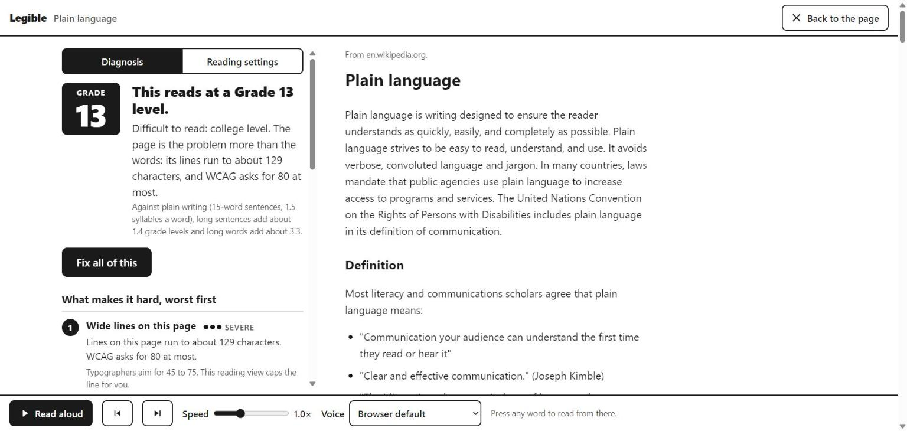
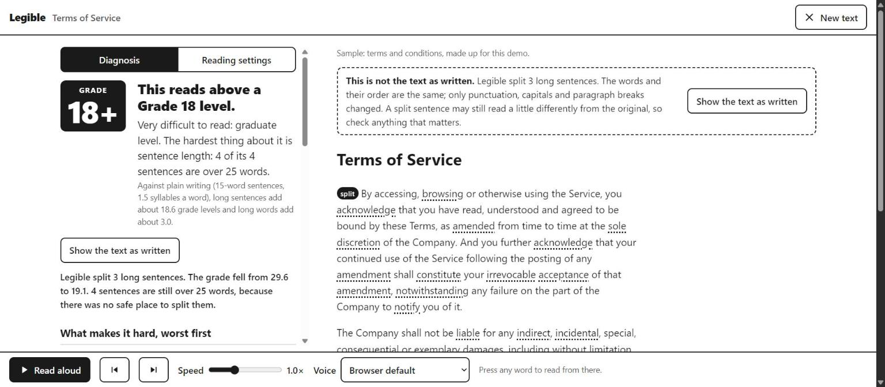
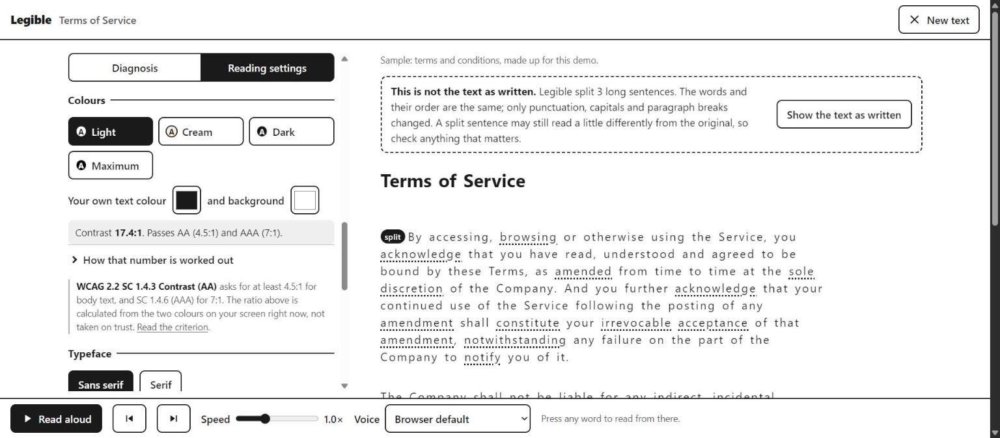
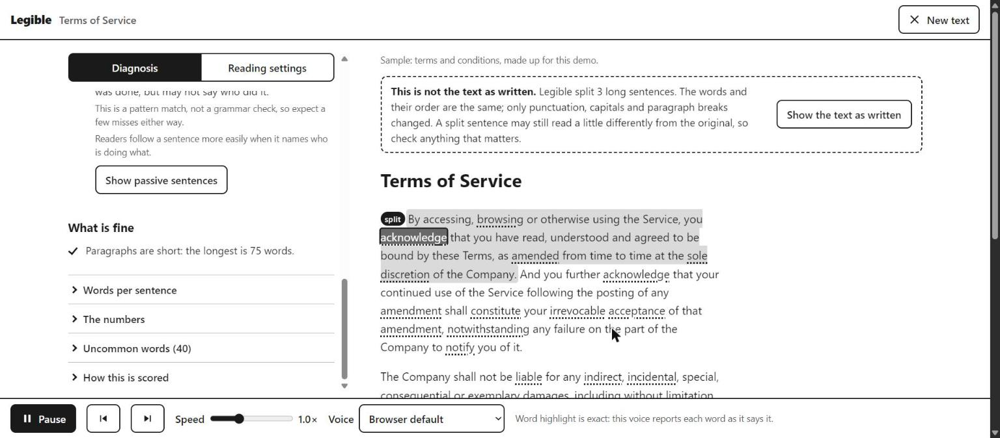

# Legible

**Finds what makes a text hard to read. Then fixes that.**

Live at **https://legible-ashy.vercel.app**. Built for Bridge The Gap Hacks, 15 to 20 November 2026.

Most reading tools give every page the same treatment: bigger text, a dark mode, a play
button. Legible measures the writing first. It works out what is hard about *this* text.
It says so in one sentence. Then it offers the fix that matches.

> **This reads at a Grade 16 level.**
> The hardest thing about it is sentence length: 86 of its 178 sentences are over 25 words.
> 703 words (18%) are outside the 5,000 most common in spoken English.
> Lines on this page run to about 118 characters. WCAG asks for 80 at most.
>
> `[ Fix all of this ]`

That is what Legible said about the GNU General Public License, read in place on gnu.org.
It is a readability analyser with a reading view attached, not a font-size slider.



*Legible opened on Wikipedia's "Plain language" article with the bookmarklet. The article
text is CC BY-SA 4.0.*

## Try it

- **Paste a text.** Open the site, paste anything, and press *Check this text*.
- **Use it on any web page.** Drag the *Legible this page* button to your bookmarks bar.
  Press it on any article. Legible opens over that page.
- **Open a file.** It reads `.txt`, `.md` and `.html` files.
- **Pick a sample.** There are four, from a wall of legal text to a plain notice.

There is no account and nothing to install. Nothing you give it leaves your device. After
one visit it works with no network at all.

## What it does

### It diagnoses before it treats

Legible measures seven things about the writing:

- the reading grade (Flesch-Kincaid) and the Flesch reading ease score
- every sentence over 25 words, and every one over 35
- words outside the 5,000 most common in spoken English
- paragraphs over 150 words
- passive voice, which is labelled an estimate because it is one

On a web page it measures the page as well. How wide are the lines? How big is the text?
How far apart do the lines sit? How much does the text stand out from its background?

Each check is put on the same scale from 0 to 1. The worst one leads. That ranking is the
point: it turns a pile of numbers into one sentence that tells you what to do. Legible also
splits the grade in two, so you can see how much comes from long sentences and how much
from long words.

It says what is fine as well. A tool that always complains is no use, so a plain text
comes back clean.

### The fix matches the problem

- **Long sentences are split** at clause boundaries, such as a semicolon or a comma before
  "and" when a full clause follows.
- **Long paragraphs are broken up** at the end of a sentence.
- **Uncommon words are underlined.** Press one to hear it on its own.

Splitting keeps one promise: **the same words, in the same order.** Only punctuation and
capital letters change. Nothing is added, dropped or rewritten, and the tests check this on
every sample. Where there is no safe place to split, Legible leaves the sentence alone and
tells you how many are left.

The original is always one tap away, for the whole text or for one sentence. Legible never
claims that a split sentence means exactly what the original did.



### Every setting cites its source

| Setting | Why it is there |
| --- | --- |
| WCAG AA spacing, in one tap | The four values from WCAG 2.2 SC 1.4.12: line height 1.5, paragraph spacing 2, letter spacing 0.12, word spacing 0.16 |
| Text size up to 300% | WCAG 2.2 SC 1.4.4 asks that text can reach 200% |
| Line length | WCAG 2.2 SC 1.4.8 asks for 80 characters or fewer |
| Colour themes, or your own colours | WCAG 2.2 SC 1.4.3 asks for a contrast of 4.5 to 1 |
| Letter spacing | Zorzi and others (2012) found it helped children with dyslexia |
| No "dyslexia font" | A 2026 review of 15 studies found no reliable benefit |
| Line focus | No strong study either way, and the interface says so |

Two of these are measured on your screen instead of being taken on trust.

**Line length.** The usual way to cap a line is the CSS `ch` unit. But `ch` is the width of
a zero, and a zero is wider than most letters, so "66ch" really holds about 75 characters.
Legible measures the true width of your text in your font at your spacing. Then it sizes
the column from that.

**Contrast.** The ratio is worked out from the two colours on your screen with the WCAG
formula. The working is shown beside it.



### It reads aloud and lights the word

Press any word and Legible reads from there, with the spoken word lit. Browsers tell a page
which word the voice has reached, but not every browser does and not every voice. So
Legible does not assume. It starts by timing the voice. If the browser reports real word
positions, it switches to those. If not, it keeps timing, and it learns the voice's true
speed as it goes. Either way it tells you which one you are getting.



### One bookmark, any page

The bookmarklet carries all of Legible inside it. It makes no network request. It opens on
top of the page you are on, and closing it puts the page back exactly as it was.

Many sites forbid outside scripts, style tags and `innerHTML`. Legible is built without any
of them, so it still works there. The repo has a locked-down test page that proves it.

## The numbers behind it

- **Syllables.** Counted from spelling. The rules alone agree with the CMU Pronouncing
  Dictionary on 98.6% of the 12,000 most common words. A table of 113 exceptions lifts
  that to 99.97% of words as they turn up in real text.
- **Sentences.** Splitting on full stops is wrong for "Dr. Rao paid $3.50 at 5 p.m. in the
  U.S. and left." Legible gets that one right, and 27 other hard cases in the tests.
- **Words.** The 5,000-word list is stored as 3,772 entries in 14 KB. Forms that Legible
  can work out for itself, such as "walked" from "walk", are left out. The build proves
  that none of the 5,000 is lost.
- **Size.** The whole tool is one script of about 100 KB, or 41 KB once compressed.
- **Privacy you can check.** The site is served with a policy of `default-src 'none'` and
  `connect-src 'self'`. Your browser itself blocks any attempt to send data elsewhere.
- **Dependencies.** None at run time. One at build time, to pack the bookmarklet.

The analyser has no need of a browser. You can run it on a file:

```
npm run analyse -- notes.txt --fix
```

## Legible is accessible too

A reading tool that fails its own readers would be the worst kind. So:

- Everything works from the keyboard, with a clear focus ring on every theme.
- Changes are announced to screen readers. Focus is put back after the panel redraws.
- Every control is at least 44 by 44 pixels.
- Nothing relies on colour alone. Marks are also shapes, and bars are also numbers.
- The interface is drawn from two colours. Every other shade is worked out from them and
  checked, so text stays above 4.5 to 1 on any theme, even one you make yourself.
- It follows your system settings for dark mode, more contrast and less motion.

## Legible on its own README

We pointed Legible at this file. It reads at Grade 6, and no sentence is over 25 words.
You can check that with `npm run self-check`. The tests fail if this README climbs above
Grade 8 or grows a sentence over 25 words. The tool keeps judging its own author.

## Honest limits

- It understands English only. It tells you if a text does not look like English.
- A grade measures how long the sentences and words are. It cannot tell if the writing
  makes sense.
- Passive voice is a pattern match, not a grammar check.
- Syllables come from spelling, so one word in a hundred or so may be off by one.
- "Uncommon" means outside one list of 5,000 word forms. A name at the start of a sentence
  can be counted as an uncommon word by mistake.
- Splitting is careful, so it leaves many long sentences alone.
- The big bookmarklet is too large for Firefox to save. The site offers a small one that
  loads the reader instead.
- Voices come from your browser. Some devices have better ones than others.

## Run it yourself

```
git clone https://github.com/Dynamox-DEV677/legible
cd legible
npm install
npm run dev        # the site, at http://localhost:4173
npm test           # the tests
npm run build      # rebuilds the bookmarklet and the offline file list
```

The site needs no build step. `index.html` loads the files in `src/` as they are.

## How the code is laid out

```
src/core/         the analyser: plain JavaScript, no browser needed
src/ui/           the reader: diagnosis, text, settings, read-aloud
src/page/         reads a web page and measures how it set its type
src/bookmarklet/  the entry point for the one-bookmark version
src/app/          the site around the reader
data/             the word list, with its sources and licences
test/             the tests, plus a locked-down page for the bookmarklet
tools/            the build, the data build, and the command-line version
```

## Sources

Each of these was read at the source before Legible cited it.

- Flesch (1948), *A new readability yardstick*, Journal of Applied Psychology 32(3).
- Kincaid, Fishburne, Rogers and Chissom (1975), *Derivation of new readability formulas
  for Navy enlisted personnel*.
- GOV.UK, [Sentence length: why 25 words is our limit](https://insidegovuk.blog.gov.uk/2014/08/04/sentence-length-why-25-words-is-our-limit/).
- Brysbaert and New (2009), [word frequencies from subtitles](https://doi.org/10.3758/BRM.41.4.977), Behavior Research Methods 41(4).
- WCAG 2.2: [1.4.12 Text Spacing](https://www.w3.org/WAI/WCAG22/Understanding/text-spacing.html),
  [1.4.4 Resize Text](https://www.w3.org/WAI/WCAG22/Understanding/resize-text.html),
  [1.4.8 Visual Presentation](https://www.w3.org/WAI/WCAG22/Understanding/visual-presentation.html),
  [1.4.3 Contrast](https://www.w3.org/WAI/WCAG22/Understanding/contrast-minimum.html).
- Zorzi and others (2012), [Extra-large letter spacing improves reading in dyslexia](https://doi.org/10.1073/pnas.1205566109), PNAS 109(28).
- Azzarello and others (2026), [a review of dyslexia-friendly fonts](https://doi.org/10.1007/s11881-026-00389-8), Annals of Dyslexia 76(3).
- Marinus and others (2016), [A special font for people with dyslexia](https://doi.org/10.1002/dys.1527), Dyslexia 22(3).
- Wery and Diliberto (2017), [on OpenDyslexic](https://doi.org/10.1007/s11881-016-0127-1), Annals of Dyslexia 67(2).
- Kuster and others (2018), [on the Dyslexie font](https://doi.org/10.1007/s11881-017-0154-6), Annals of Dyslexia 68(1).

## Licence

The code is under the MIT licence. The word list comes from film and television subtitles
and is shared under CC BY-SA 4.0. The syllable reference comes from the CMU Pronouncing
Dictionary. The details are in [data/README.md](data/README.md).

Made by Dynamox-DEV677 at Kairo Industries, with Claude Code as a pair programmer. Every
commit says so.
